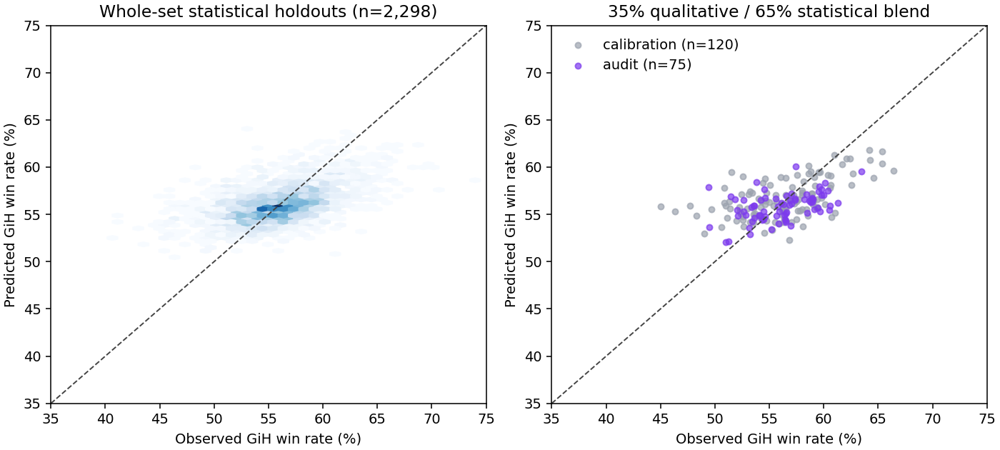

# Star Trek Premier Draft GiH forecast — GPT-6

The submission is the single two-column table [`predictions.csv`](../../predictions.csv): **311 distinct TRK card names**, one probability per name. `0.5821` means **58.21%**. Rates are forecasts of 17Lands game-in-hand results, not pick orders, cast win rates, or causal estimates of adding a card to a deck. The branch is `gpt-6`.

## Scope and source boundary

Only the supplied frozen files were used for card information, rules, and outcomes. No Star Trek results, reviews, ratings, articles, or other new-set information were retrieved. Network package installation was restricted to generic Python packages from PyPI. GitHub access was used to publish this analysis, not to obtain card information. Card prices, popularity ranks, images, flavor text, and external links were excluded from model features.

The observed TRK extract contains 576 printings and 311 distinct names, with canonical collector numbers 1–311. Alternate treatments are collapsed. All 311 canonical names have an Arena-enabled printing. The table includes the five basics because they can be in Premier Draft hands; their predictions concern deck populations rather than spell quality. The user explicitly confirmed the 311-card TRK pool. The 30 SDS records are all marked paper-only and are excluded. No TRC or other Commander cards are added. The `booster` flag is false throughout the new extracts, so it cannot distinguish draft eligibility. The README's nominal printing count is not used as a card-name count. No external Arena collation information was consulted.

The historical window is FIN, EOE, OM1, TLA, ECL, TMT, SOS, MSH, HOB, and FRA. Nine have Premier Draft files; OM1 has PickTwoDraft instead. Its format remains labeled throughout, and principal validation metrics exclude it. Oracle names in OM1 were mapped to the supplied `printed_name` Arena names. Double-faced cards were matched to front-face game-data names where necessary. Reversible cosmetic treatments were deduplicated. Unmatched bonus-sheet cards retain their outcome aggregates but do not enter the text model without supplied card text.

SHA-256 hashes cover all twelve card extracts, the two textual rules documents, and the ten game files. The analysis did not refresh or download any card or outcome datasets.

## Historical target construction

The ten files contain **4,392,417 games**. For each game/card pair:

```
in_hand = opening_hand_count > 0 OR drawn_count > 0
GiH = wins in those games / number of those games
```

Each game contributes at most once per card, regardless of copies. Tutored-only observations do not count, following the supplied demo's definition. Wins and denominators are also accumulated separately for opening hands and decks. This preserves the distinction between actually seeing a card and merely including it. Historical set win rates range from 54.99% to 56.80%; the unweighted set baseline is about 55.74%.

The training table has 2,521 card/set observations with at least 100 GiH games. A separate `csv.DictReader` implementation recomputed the entire FRA file for a basic land, common removal spell, mythic, and poorly played rare, and matched all counts exactly. It also independently matched FRA's 297,964 games and 165,143 wins.

## Statistical models and validation

Features include casting cost and colored-pip demands; hybrid costs; rarity; card types; front-face stats; variable stats; intrinsic and granted keywords; immediate versus recurring effects; modal choices; removal restrictions; token bodies; card selection and advantage; graveyard use; activation requirements; and station thresholds. An extended feature pass distinguishes initial bodies, immediate ETB value, conditional engines, and token power from printed stats. Set-level support measurements use only printed common/uncommon card information.

Text features use normalized Oracle text with self names and reminder text removed, plus word n-grams. No externally trained embeddings or external card-rating model were used. Candidate models were regularized Ridge regressions, CatBoost trees with and without text-SVD features, and ExtraTrees. All seeds are fixed.

Training predicts percentage-point deviations from each historical set's overall game win rate. A held-out set receives a baseline estimated **only from the other sets**. Observation weights are `n / (n + 1000)`, limiting noise from scarce appearances. Complete sets, rather than random cards, are held out. This tests transfer across mechanics and environments. It is leave-one-set-out validation, not a claim that every fold is chronological; the latest-set FRA holdout is also a genuine forward holdout against the other nine sets.

The chosen statistical prediction is an equal blend of the original-feature Ridge model (`alpha=3`, numeric feature scale 0.15) and the extended-feature CatBoost model (depth 6, 1,200 iterations, learning rate 0.025, L2 12). Its Premier Draft holdout results, for cards with at least 500 GiH games, are:

| Predictor | RMSE, percentage points |
| --- | ---: |
| Population baseline | 3.780 |
| Rarity-only baseline | 3.643 |
| Best individual Ridge | 3.293 |
| Extended CatBoost | 3.291 |
| Selected statistical blend | **3.219** |

This covers 2,298 observations. FRA holdout RMSE is 3.160 points. The hardest set is HOB at 3.652; TLA is 2.952. Statistical-blend RMSE is 3.543 when the threshold is lowered to 100 observations, and 2.971 above 2,000 observations. These differences matter: sparsely played build-arounds are systematically overestimated, not merely noisy.

Additional experiments included 18 nearest-text/role analogue configurations; pooling near-exact reprints; equal and asymmetric model ensembles; changing the sample-count prior to 0 or 250; and an auxiliary deck-inclusion prediction. Broad analogue averaging was weaker than the selected model. The best near-exact tweak improved RMSE by less than 0.001 point, so it was rejected as immaterial. Unweighted training reduced some low-play bias but worsened the principal validation result. Historical analogues remain useful for individual review rather than becoming a general automated replacement.



## Independent qualitative calibration

I read every target card and recorded a numerical prior, likely archetypes, and a card-specific rationale in `target_ratings.tsv`. That review considers mana efficiency, defensive and offensive usefulness, immediate value, ETB reuse, artifact versus nonartifact status, synergy availability, and competing cards. It does not equate rarity or a long text box with power.

To calibrate the contribution of that judgment, I froze ratings for a stratified sample of **120 historical cards** before viewing their individual outcomes. The first sample revealed substantial overvaluation of conditional engines. After examining those errors, I froze a distinct **75-card audit sample** before revealing its outcomes. The files preserve both sets of original ratings, including mistakes; they were not rewritten to agree with outcomes. The samples were selected from eight sets, excluding EOE/OM1, whose top/bottom rankings had already been inspected.

On the combined 195 cards, a **35% qualitative / 65% statistical** blend has roughly 3.09-point RMSE, versus 3.23 for statistics alone. Selecting the blend weight while holding out each sample's whole set gives roughly 3.10-point RMSE; weights across folds are close to 0.30–0.39. On the 75-card audit, the fixed 35% blend scores **2.652**, compared with **2.939** for statistics alone. The initial 120-card sample is harder and improves only modestly. These are small samples, and the audit followed learning from the calibration sample; they are not 195 completely independent preregistered judgments.

The ordinary final estimate uses the 35/65 blend. Thirty-five cards receive explicitly recorded revisions in `review_adjustments.tsv`, generally raising the qualitative weight to 50–85% when the text model misreads a rule or a particularly unusual payoff. Their resulting weights and complete numerical decomposition are in `prediction_components.csv`. **The validation scores above do not validate these target-only revisions.** They are transparent judgments made without target outcomes.

## Star Trek environment and rules review

The comprehensive rules were read alongside the release-note supplement. Relevant distinctions include:

* Station can use a newly entered creature: it is not that creature's tap-symbol ability. It accumulates charge counters permanently, is sorcery-speed, and can still be activated after the final threshold. Printed ship power/toughness is not an immediately available creature. Vigilance, untap effects, temporary power pumps, and cheap extra bodies change station economics.
* Beam me up returns a creature as a cost, observes spell timing, and exiles the spell afterward. Its value includes ETB reuse, but both the return and replay cost tempo. Marooned specifically prevents using the enchanted permanent for that cost. Ordinary bounce and blink remain distinct.
* Choosing several modes is one dilemma. Modal ETB and attack abilities count, not just spells. Tal Shiar Operative is especially useful because its attack supplies recurring choices. Hybrid cards are playable when either side of each hybrid symbol is available.
* Federation excludes Borg entirely and counts distinct **creature types**, not creatures. Saavik and Hoshi count their own types. Strange new worlds counts names among lands currently controlled, not land drops or basic land types; repeated New Planet tokens share one name.
* Assimilation's benefits and timing depend on the particular card. Borg Cube initially exiles when it has no linked creature to assimilate; it does not immediately steal that creature. Mirror Universe Intrusion does not copy accumulated counters, while Dominion Saboteur specifically does. The release notes confirm Mirror Universe Intrusion's full kicker cost despite the abbreviated reminder in the card extract.
* Quark forbids sacrificing Treasure tokens for **any** cost. Kobayashi Maru can force a fourth-upkeep loss; actual escape routes include sacrificing it to Dahar Master, resetting it with Ghost of Illyria, donating it with Rules of Acquisition, or countering the loss trigger with T'Pol. Those combinations cannot be assumed in every deck.
* The City on the Edge of Forever can let the opponent's old board phase in first, depending on when its token leaves. The Measure of a Man normally returns its exiled permanent. These are not unconditional permanent sweepers/removal spells.

The ten pair plans were considered together:

| Pair | Main plan and constraints |
| --- | --- |
| WU | Ships, tap/untap, ETB reuse. Good ETB ships are useful before stationing; high thresholds without immediate value are risky. |
| WB | Borg/artifact creatures, tokens, lords, sacrifice. Many natural common bodies support the payoffs; generic artifact tokens do not automatically satisfy artifact-**creature** conditions. |
| UB | Dilemmas, selection, value. Numerous modal creatures/spells and repeatable attack choices support Garak, Seven, Jett and Melkotian Adjudicator. |
| UR | Noncreature spells, Officers, tempo. Ships count as noncreature casts, but spell density must leave enough creatures to defend and station. |
| BR | Klingons, sacrifice, menace, death value. Disposable bodies support Eject and Dahar; expensive setup enchantments still incur tempo costs. |
| BG | Self-mill, recursion and cards leaving graveyards. Beam up, exile abilities and Cybernetic Specialist support Vash/Stalker; the graveyard must actually be stocked. |
| RG | Landfall, temporary/additional lands, large bodies. Reducing the deck's defensive curve for speculative landfall engines is costly. |
| GW | Counters, Doctors, trample, lifegain. Effects with useful initial bodies are more reliable than enchantments requiring several later creatures. |
| RW | Wide pressure and total power eight. The threshold counts nonattacking creatures too; small tokens need pumps or other bodies, and taplands can slow pressure. |
| GU | Distinct lands, fixing, ramp and large payoffs. Support exists, but ordinary two-color basics do not naturally turn on five- or seven-name thresholds. |

## Quantitative support checks

`scenarios.py` performs seeded support calculations, **not a full Magic game simulation**. It uses hypergeometric search probabilities and availability-weighted creature-type samples; it does not invent precise booster collation, combat outcomes, or game survival probabilities.

For a 17-land base with six different singleton nonbasics and basic counts 6/5, six sampled lands average about **4.00 distinct names**; five or more names occur about **28.8%** of the time. With only four singleton nonbasics, that probability is about **8.1%**. Those are conditional mana-base examples, not forecasts of reaching six lands on a particular turn. Actual repeated nonbasics and sacrificed fetchlands can reduce diversity; ramp and careful construction can improve it. They motivate caution on Deep Space Scan, expensive reductions, and Seven's thresholds.

Search calculations vary targets remaining rather than assuming a guaranteed hit. The creature-type simulations exclude Borg, include hybrid accessibility, and distinguish owning three creatures from having five or ten types. Pool counts expose both modal depth and the concentration of common artifact creatures in WB. All scenario assumptions and results are saved in `mechanic_scenarios.json`.

EOE supplies direct station evidence: Lumen-Class Frigate and Synthesizer Labship reward early station levels, whereas Galvanizing Sawship and several expensive ships underperform despite large eventual bodies. Those observations informed D-7, Enterprise-D, and the distinction between useful ETB ships and delayed payoffs. Related historical anthem/token cards also informed Picard's exceptional estimate.

## Artifacts and reproduction

The committed artifacts include raw historical aggregates, all model holdout predictions, model comparison metrics, original qualitative ratings and audit mappings, scenario outputs, input hashes, final per-card decomposition, scope exclusions, and validation checks. Larger diagnostic CSVs are gzip-compressed. `submission_manifest.json` records the table hash, row count, range and scope. The input card/rules/game files themselves remain in the supplied dataset rather than being duplicated into the PR.

From the repository root, with the frozen files at `/workspace/mtg-data`:

```bash
python -m pip install -r analysis/gpt-6/requirements.txt
OPENBLAS_NUM_THREADS=1 python analysis/gpt-6/prepare.py
OPENBLAS_NUM_THREADS=1 python analysis/gpt-6/model.py --legacy
OPENBLAS_NUM_THREADS=1 python analysis/gpt-6/model.py
OPENBLAS_NUM_THREADS=1 python analysis/gpt-6/analogues.py
OPENBLAS_NUM_THREADS=1 python analysis/gpt-6/calibrate.py
OPENBLAS_NUM_THREADS=1 python analysis/gpt-6/scenarios.py
OPENBLAS_NUM_THREADS=1 python analysis/gpt-6/finalize.py
```

The fixed qualitative inputs are already committed; rebuilding them would be a new judgment exercise. Delete cached `cv_*.csv` files before changing model features. `weight_experiments.py` reproduces the rejected sample-weight/playability experiments. `publish_artifacts.py` creates compact diagnostics and the validation figure.

Remaining uncertainty concerns actual deck populations, draft adaptation, color balance, rare combo selection, and low-count realized rates. These cannot be established from prerelease card text. GiH is observational and influenced by player and deck selection. The forecast therefore uses calibrated shrinkage for most cards while documenting the narrower cases where rules-specific judgment overrules that shrinkage.
